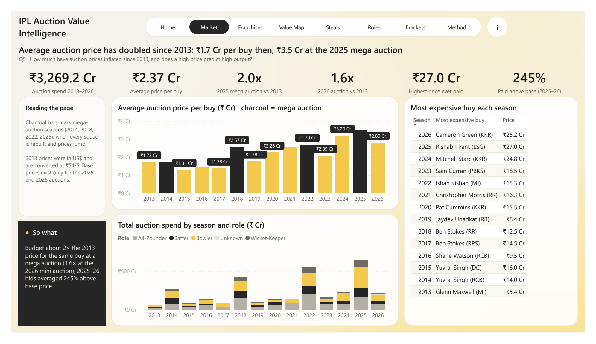
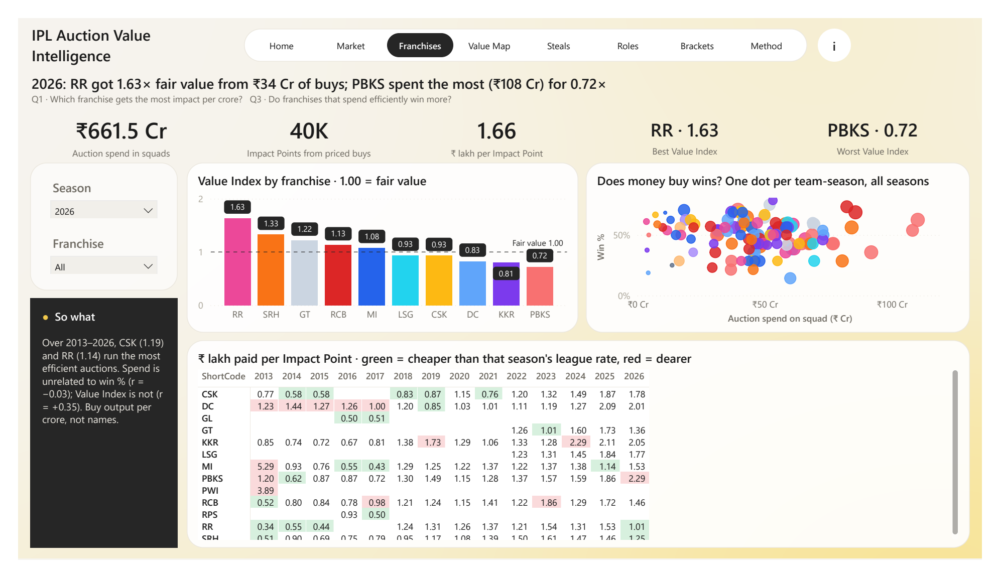
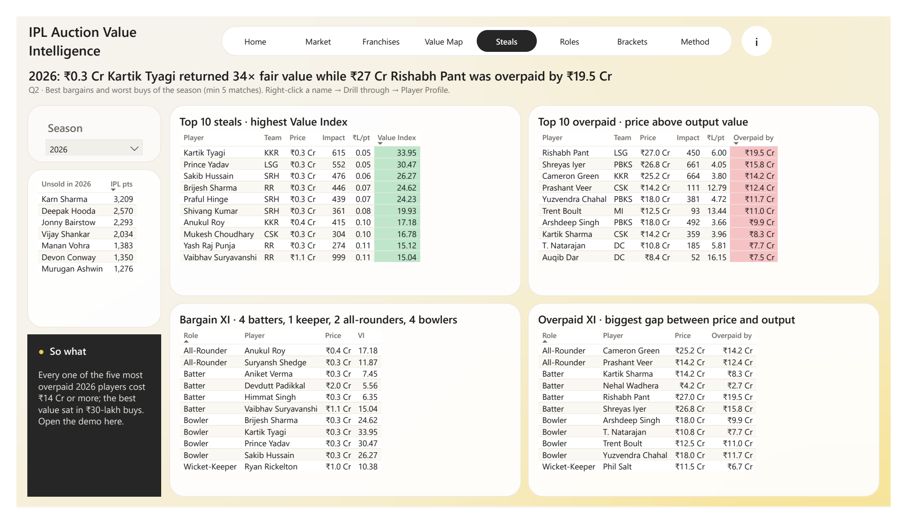
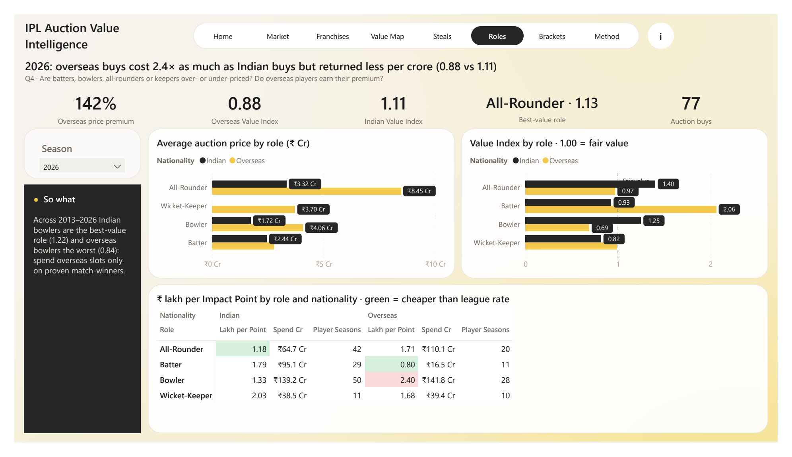
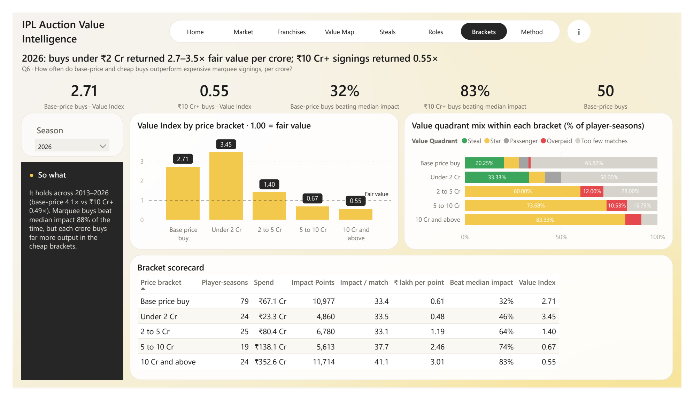

# IPL Auction Value Intelligence: project report

**BDM project · Power BI component** · October 2026 · Prepared by Nabaskar

## 1. Problem

Every December, IPL franchises spend hundreds of crores at auction. They pay for reputation, but they win with runs, wickets and catches. This project asks one question from a franchise analytics team's point of view: **which auction buys earned their price?** We scored every IPL auction buy from 2013 to 2026 on its on-field output per crore, and rolled that up to franchises, roles, nationalities, price brackets and seasons.

The report answers six business questions:

1. Which franchise gets the most on-field impact per crore spent?
2. Which players were the best bargains and the worst buys each season?
3. Do franchises that spend efficiently win more matches?
4. Are batters, bowlers, all-rounders or keepers over- or under-priced, and do overseas players earn their premium?
5. How much have auction prices inflated since 2013, and does a high price predict high output?
6. How often do base-price buys outperform expensive marquee signings?

## 2. Data sources

| Source | What it gives | Grain |
| --- | --- | --- |
| Kaggle, *IPL Auction Dataset 2013–2026* (sunnyyadav754) | Price, team, role, nationality, base price (2025–26) | One CSV per auction, 1,380 buys |
| Cricsheet IPL JSON (Oct 2026 release) | Every ball, fielders, playing XIs, results | 1,243 matches (921 in 2013–2026) |
| Cricsheet Register (`people.csv`, `names.csv`) | Player IDs and name variants | One row per person / variant |
| Kaggle, *IPL Player Auction Dataset 2013–2022* + official TATA IPL 2025 auction list | Role and Indian/Overseas flags missing from some years | One row per buy |
| Wisden, *IPL 2026 unsold list* | Unsold players at the latest auction | 79 players |
| Hand-made `team_map.csv`, `name_fixes.csv` | Franchise renames; 96 checked name matches | — |

The PRD named a Kaggle ball-by-ball CSV as the performance source. That file has no fielder column, so catches, stumpings and run-outs could not be scored from it. We used Cricsheet's JSON instead, which is the upstream source of that CSV and also gives a Cricsheet ID for every player.

## 3. Data preparation (Power Query)

All cleaning is done in Power Query, so **Refresh** rebuilds everything from `data/raw`. Every query reads a single `DataFolder` parameter. Staging queries (`stg_…`) are not loaded.

1. **Auction files.** One rename function reads each year's headers (they differ by year) and outputs a standard table. Prices are converted to crores: rupee strings ÷ 10⁷, lakhs ÷ 100, and 2013 US$ × ₹54. Role and nationality gaps are filled from the backup datasets.
2. **Match JSON.** One function parses each match into three tables: playing XIs, deliveries and fielding credits. Super overs are excluded, and season = calendar year ("2020/21" → 2020).
3. **Player-season stats.** Batting (runs, balls faced excluding wides, 4s, 6s), bowling (legal balls, runs conceded excluding byes and leg-byes, dot balls, bowler wickets excluding run-outs and retirements) and fielding (catches, stumpings, run-out involvements) are grouped by season × player × team.
4. **Name matching, auction name → Cricsheet ID, in six passes:** manual fixes → exact unique name → exact unique in the whole register → initials ("Virat Kohli" → "V Kohli") within that team's roster → surname + first initial within the roster → Power Query fuzzy merge (≥ 0.8) within the roster. **99.0% of auction spend is matched.** Most of the 66 unmatched buys never played a match.
5. **Contracts.** A price covers the auction season and later seasons until the earliest of: the player's next auction − 1, the next mega auction − 1 (2014, 2018, 2022, 2025), or 2026. Later seasons count only while the player still plays for that team.
6. **Facts and dimensions.** Stats and contracts are full-outer-joined into `FactPlayerSeason`. Players with no auction price that season (retained or traded) are labelled *Unpriced*.

## 4. Data model

A star schema: three facts, four dimensions, every relationship one-to-many and single-direction.

| Table | Grain | Rows |
| --- | --- | --- |
| FactPlayerSeason | player × season × team (stats + auction price) | 2,910 |
| FactAuction | one auction buy | 1,380 |
| FactTeamMatch | team × match (Won, NoResult) | 1,842 |
| DimPlayer | player (Cricsheet ID) | 778 |
| DimTeam · DimSeason · DimTeamSeason | franchise · season · franchise-season | 13 · 14 · 123 |

All 93 measures sit in one `_Measures` table, in display folders Money, Performance, Value, Team, QA and Formatting.

## 5. The value metric

**Impact Points** put batting, bowling and fielding on one fantasy-style scale: run 1, four +1, six +2, wicket 25, dot ball 1, catch 8, stumping 12, run-out involvement 6.

**Value Index** = (share of league Impact Points) ÷ (share of league auction spend), computed season by season so each buy is judged against its own market. 1.00 is fair value. The league total is exactly 1.00 in every season, and this is checked on the QA page.

**Overpay** = price − fair value, where fair value = Impact Points × that season's league ₹ per point.

**Value quadrant:** each priced player-season is compared with that season's median price and median impact. The result is **Star** (dear, high impact), **Steal** (cheap, high impact), **Overpaid** (dear, low impact) or **Passenger** (cheap, low impact). Under 5 matches is labelled *Too few matches*.

## 6. Key findings

**Prices have doubled.** The average buy cost ₹1.7 Cr in 2013 and ₹3.5 Cr at the 2025 mega auction (2.0×). Mega auctions drive the jumps, and in 2025–26 teams bid 245% above base price on average.

**Money does not buy wins; value does.** Across 123 team-seasons, auction spend is unrelated to win % (r = −0.03), but Value Index is not (r = +0.35). Over 2013–2026, CSK (1.19) and RR (1.14) run the most efficient auctions and DC (0.85) the least. In 2026, RR got 1.63× fair value from ₹34 Cr of buys, while PBKS spent the most (₹108 Cr) for 0.72×.

**The best value sits in ₹30-lakh buys.** In 2026, Kartik Tyagi (₹0.3 Cr) returned 34× fair value. Rishabh Pant (₹27 Cr) was overpaid by ₹19.5 Cr, and Cameron Green (₹25.2 Cr) by ₹14.2 Cr. Each of the five most overpaid 2026 players cost ₹14 Cr or more. Karn Sharma, Deepak Hooda and Jonny Bairstow went unsold despite strong IPL records.

**Overseas premiums are not earned on average.** In 2026, overseas buys cost 2.4× as much as Indian buys, yet returned less per crore (0.88 vs 1.11). Over 2013–2026, Indian bowlers are the best-value role (1.22) and overseas bowlers the worst (0.84).

**Cheap brackets buy far more output per crore.** Over 2013–2026, base-price buys return a Value Index of 4.1 and ₹10 Cr+ signings 0.49. Marquee players still beat median impact 88% of the time against 24% for base-price buys, so they do win games. Each crore simply buys much more in the cheap brackets.

**Recommendation for the next auction:** keep the Steals and Stars, release the Overpaid and Passengers, spend overseas slots only on proven match-winners, and build depth from the base-price pool.

## 7. Validation (PRD section 9)

| Check | Result |
| --- | --- |
| Matches per season | 2013: 76 · 2014–21: 59–60 · 2022–26: 74 (2024: 71, three washouts) |
| Orange / Purple Caps | 2016 Kohli 973 / Bhuvneshwar 23 · 2023 Gill 890 / Shami 28 · 2024 Kohli 741 / Harshal 24, matching iplt20.com |
| 2026 auction | 77 players, ₹215.45 Cr |
| Highest price | Rishabh Pant ₹27 Cr (2025) |
| Null/zero prices · unmapped teams · contract rows past a mega auction | 0 · 0 · 0 |
| Spend matched to Cricsheet | 99.0% (target ≥ 95%) |
| League Value Index per season | 1.00 in all 14 seasons |
| Average win % per season | 49–50% |
| Independent re-computation | A separate pandas pipeline gives identical numbers (e.g. Kohli 2016: 1,187 Impact Points) |

## 8. Limitations

- **Retained players are excluded.** Long-time retainees (e.g. Kohli, Bumrah) have no auction price, so they are *Unpriced* and left out of value measures.
- **2013 exchange rate.** 2013 prices are converted at a single US$ rate (₹54/$).
- **Base prices.** They are published only for 2025–26. Earlier, a buy at that era's minimum base price counts as a base-price buy.
- **Impact Points weights are a judgement call.** The runs-only and wickets-only measures put the same players at the top of the tables.
- **Unmatched names.** 1% of auction spend (mostly players who never played) is not matched to Cricsheet.
